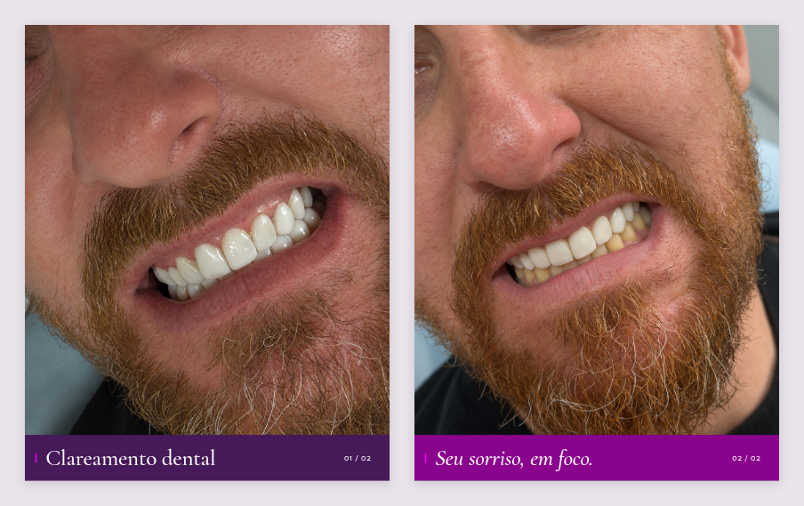

# Clareamento dental — resultado em foco

**[Versão refeita com acabamento editorial — baixar V2](../clareamento-resultado-2cards-v2-2026-11-05/)**

Dois cards em 1080 × 1350 (4:5), com texto mínimo e aproximadamente 90% da área dedicada à fotografia. Paleta e tipografia conforme o manual da marca.

## Downloads

- [Baixar pacote completo](./Carrossel-resultado-completo.zip?raw=true)
- [Card 01 — Clareamento dental](./Card-01-resultado.png?raw=true)
- [Card 02 — Seu sorriso, em foco](./Card-02-resultado.png?raw=true)
- [PDF dos dois cards](./Carrossel-resultado.pdf?raw=true)
- [Legenda sugerida](./Legenda-sugerida.txt)

Publique na ordem 01 → 02. As fotos originais foram preservadas. O logo original ainda não estava disponível e não foi recriado.
