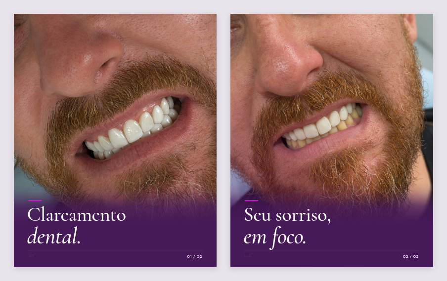

# Clareamento dental — edição editorial V2

Dois cards em 1080 × 1350 (4:5), refeitos com o acabamento do carrossel anterior: degradês roxos integrando foto e fundo, títulos grandes em Cormorant, itálico, traços magenta e paginação Montserrat. Texto mínimo e sorriso em destaque.

## Downloads

- [Baixar pacote completo V2](./Carrossel-resultado-v2.zip?raw=true)
- [Card 01 — Clareamento dental](./Card-01-resultado.png?raw=true)
- [Card 02 — Seu sorriso, em foco](./Card-02-resultado.png?raw=true)
- [PDF dos dois cards](./Carrossel-resultado.pdf?raw=true)
- [Legenda sugerida](./Legenda-sugerida.txt)

Publique na ordem 01 → 02. Fotos originais preservadas. O logo não foi aplicado porque o arquivo original ainda estava indisponível.
